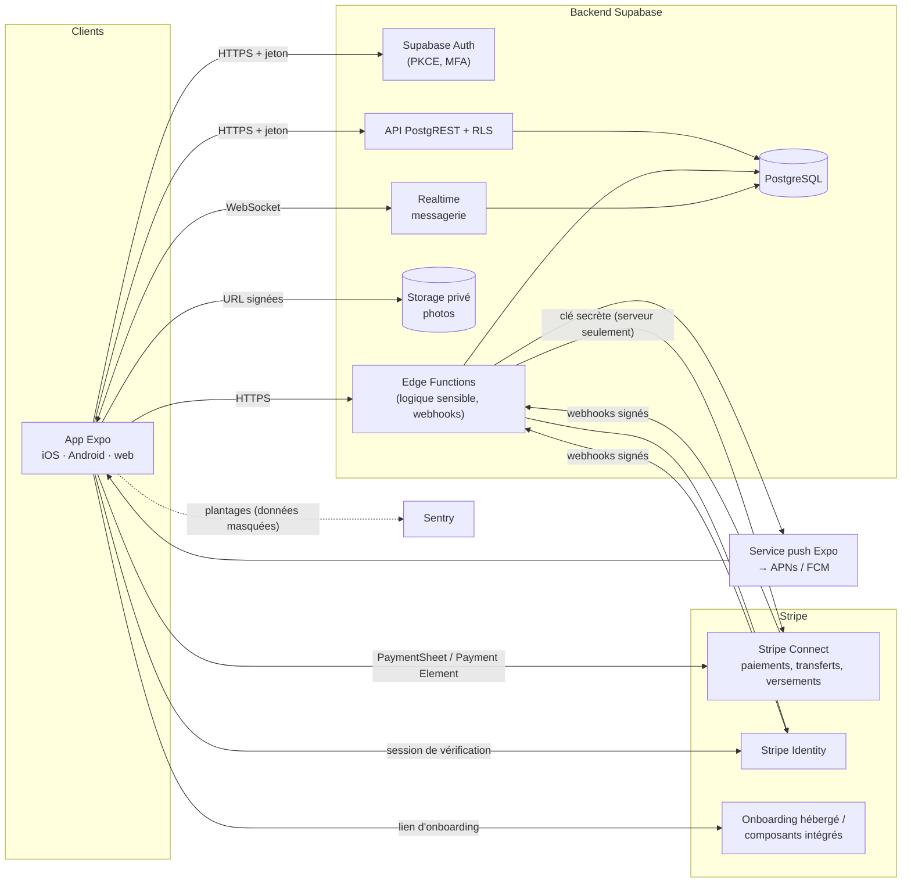
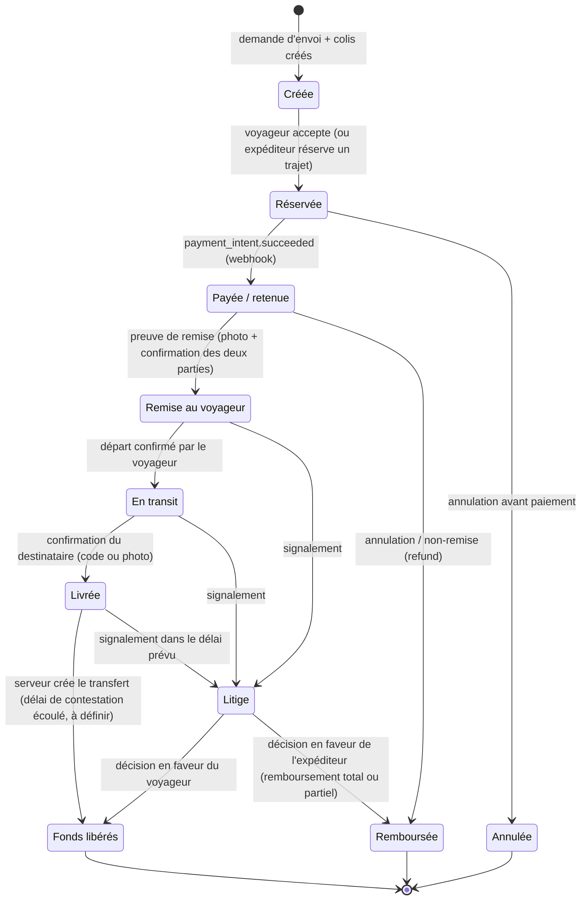

> **Portée de cette section.** Ce document couvre la partie technique du cahier des charges de Volis (application de mise en relation entre expéditeurs de colis et voyageurs, sur iOS, Android et web). Il doit être assemblé avec la section de l'équipe UI (fonctionnalités et parcours) et avec la section de l'équipe juridique (`cahier-legal-monetisation.md`, « Volet légal de la monétisation »). Les aspects légaux et fiscaux relèvent de l'équipe juridique et d'un avocat membre du Barreau du Québec. Ils ne sont repris ici que pour en déduire des exigences techniques.
>
> **Sources :** fiche « Projet Volis — Fiche de recherche » (11 octobre 2026), « Guide sécurité et architecture mobile » (déjà fourni), documentation officielle Expo, Stripe et OWASP MASVS v2.1.0. **Convention :** tout ce qui n'a pas été vérifié dans une source officielle est marqué **« à confirmer »**. Aucun montant, taux ni objectif chiffré n'est fixé ici : ils restent **à décider par Faycal**.

# 1. Stack technique justifiée

## 1.1 Vue d'ensemble

| Besoin | Choix | Justification | Statut |
|---|---|---|---|
| App iOS, Android, web | **Expo (React Native) + Expo Router + TypeScript** | Un seul code pour les trois plateformes, routage par fichiers commun au mobile et au web, maquettes déjà prêtes pour cette approche, TypeScript pour typer le domaine et les contrats d'API. | Retenu (fiche de recherche) |
| Backend | **Supabase** (recommandé, voir 1.2) | Auth, PostgreSQL, sécurité par ligne (RLS), stockage, temps réel et fonctions serveur réunis, ce qui convient à une petite équipe. | Recommandé |
| Vérification d'identité | **Stripe Identity** (pièce d'identité + égoportrait) | Vérification déléguée à Stripe ; Volis ne stocke que le statut et l'ID de session. | Retenu |
| Paiements de la place de marché | **Stripe Connect, « separate charges and transfers »** | Le paiement est encaissé sur le compte de la plateforme puis transféré au voyageur seulement quand le serveur confirme la remise. Une pré-autorisation de carte en ligne expire généralement après 7 jours (doc Stripe), ce qui ne suffit pas pour un trajet. Connect gère le KYC des voyageurs. | Retenu |
| Notifications push | **Expo Notifications** (service push d'Expo vers APNs et FCM) | Une seule API pour iOS et Android ; jetons d'appareil enregistrés côté serveur. | Retenu |
| Cartes et géolocalisation | `expo-location` + composant de carte (par ex. `react-native-maps` sur mobile ; équivalent web à choisir) | La localisation n'est demandée qu'en contexte, désactivée par défaut (Loi 25, MASVS-PRIVACY-1). Géocodage via le backend pour ne pas exposer de clé facturée. | Fournisseur de cartes **à confirmer** |
| Photos de remise et de litige | **Supabase Storage**, compartiments privés, URL signées de courte durée | Pas d'accès public ; métadonnées EXIF (dont GPS) retirées avant stockage. | Retenu |
| Messagerie entre utilisateurs | Table `messages` dans PostgreSQL + **Supabase Realtime** | Messages liés à une réservation, protégés par RLS, modérables. | Retenu |
| Internationalisation | `expo-localization` + bibliothèque i18n (par ex. i18next) ; `I18nManager` pour l'arabe (droite à gauche) ; `Intl` pour les nombres et devises | Français (par défaut au Québec), anglais, arabe en RTL ; montants en unités mineures entières + code devise ISO 4217. | Bibliothèque i18n **à confirmer** |
| Analytics et monitoring | **Sentry** (plantages, performance) ; outil d'analytics produit **à confirmer** | Données personnelles masquées avant envoi ; analytics non essentielles uniquement après consentement. | Partiellement retenu |
| CI/CD | **GitHub Actions** (lint, tests, analyses de sécurité) + **EAS Build / EAS Submit** (builds signés et envoi aux stores) ; EAS Update pour les correctifs JavaScript **à confirmer** | Pipeline reproductible, signature gérée hors du dépôt. | Retenu |

## 1.2 Backend : Supabase ou Node/NestJS + PostgreSQL

| Critère | Supabase | Node/NestJS + PostgreSQL |
|---|---|---|
| Mise en route | Rapide : Auth, base, stockage, temps réel et fonctions fournis | Plus lente : tout est à assembler (auth, stockage, temps réel, hébergement) |
| Autorisation | RLS dans PostgreSQL, au niveau des lignes, plus des contrôles dans les fonctions serveur | Gardes et contrôles dans le code de chaque route |
| Webhooks Stripe | Edge Function (Deno) avec vérification de signature | Route NestJS dédiée ; écosystème Node standard |
| Logique métier complexe | Fonctions SQL et Edge Functions ; demande de la rigueur pour ne pas disperser la logique | Très flexible, architecture en modules |
| Exploitation | Service géré ; dépendance à un fournisseur | Plus de contrôle, plus de travail d'exploitation (mises à jour, sauvegardes, montée en charge) |
| Hébergement au Canada | Région canadienne : **à confirmer** | Selon l'hébergeur choisi : **à confirmer** |

**Recommandation : Supabase** pour le MVP. La plateforme fournit les briques nécessaires à Volis (Auth avec PKCE et MFA, RLS, stockage privé, temps réel pour la messagerie). La logique sensible reste côté serveur :

- La machine d'états des livraisons et la libération des fonds se font uniquement dans des fonctions serveur (Edge Functions ou fonctions PostgreSQL `SECURITY DEFINER`), jamais depuis l'app.
- L'app n'a aucun droit d'écriture direct sur les tables `payments`, `transfers` et `deliveries.status`.
- Pour garder une porte de sortie, les règles métier sont écrites en TypeScript pur (couche domaine partagée) et la base reste du PostgreSQL standard. Une migration vers NestJS + PostgreSQL resterait possible si les besoins dépassent les Edge Functions.

> **Règle d'or (fiche de recherche) :** c'est le serveur qui décide de libérer un paiement, jamais l'application.

# 2. Architecture

## 2.1 Schéma du système



## 2.2 Couches côté application

Conformément au guide (architecture « Clean Architecture pragmatique ») :

| Couche | Contenu dans Volis | Règles |
|---|---|---|
| **UI (MVVM)** | Écrans Expo Router ; hooks jouant le rôle de ViewModel (`useTripSearchViewModel`, etc.) qui exposent un état d'écran immuable ; flux unidirectionnel | L'UI n'appelle jamais le réseau ni le stockage directement. Elle affiche les statuts fournis par le serveur. |
| **Domaine (optionnel)** | Types métier (`Delivery`, `Booking`, `Money`), règles pures (transitions d'états permises côté affichage, calcul de l'affichage du détail de prix reçu du serveur) | TypeScript pur, sans dépendance React Native ; testé unitairement. |
| **Data (repositories)** | `TripsRepository`, `BookingsRepository`, `PaymentsRepository`, `MessagesRepository`… ; client Supabase, client HTTP des Edge Functions, cache (TanStack Query), stockage sécurisé | Point unique pour les jetons, la validation des réponses, la gestion des erreurs et le cache hors-ligne. |

## 2.3 Structure de dossiers type

```text
volis/
  app/                         # routes Expo Router (iOS, Android, web)
    (auth)/  connexion.tsx, inscription.tsx
    (tabs)/  trajets/, envois/, messages/, profil/
    reservation/[id].tsx
    litige/[id].tsx
    _layout.tsx                # fournisseurs (i18n, thème, requêtes, session)
  src/
    features/                  # une fonctionnalité = écrans + ViewModels + composants
      trips/  shipments/  bookings/  payments/  identity/
      messaging/  disputes/  reviews/  account/  payouts/
    domain/                    # types et règles pures (sans React Native)
    data/
      api/                     # client Supabase, client Edge Functions, intercepteurs
      repositories/
      secure/                  # wrapper expo-secure-store
      cache/                   # persistance hors-ligne (non sensible)
    ui/                        # design system (thème « Carnet de voyage » / « Scrapbook »)
    i18n/                      # fr, en, ar (RTL)
    test/                      # fakes, utilitaires
  supabase/
    migrations/                # schéma SQL versionné + politiques RLS
    functions/                 # Edge Functions (stripe-webhook, release-funds, …)
    tests/                     # tests RLS et tests de fonctions
  .github/workflows/           # CI
  eas.json  app.config.ts
```

## 2.4 Modèle de données principal

| Entité | Champs principaux (indicatifs) | Remarques |
|---|---|---|
| `users` (profils) | `id` (= Auth), nom affiché, langue, pays, `identity_status`, `stripe_identity_session_id`, `stripe_account_id` (voyageur), `stripe_customer_id` (expéditeur), dates de consentement, `deleted_at` | **Aucune image biométrique ni donnée bancaire.** |
| `trips` (annonces de trajet) | `id`, `traveler_id`, origine, destination, dates, capacité déclarée, restrictions, statut | Publiées par les voyageurs. |
| `shipment_requests` (demandes d'envoi) | `id`, `sender_id`, origine, destination, fenêtre de dates, statut | Publiées par les expéditeurs. |
| `parcels` (colis) | `id`, `shipment_request_id`, description, dimensions/poids déclarés, `declared_value` + devise, attestation du contenu (horodatée), photos de dépôt | Liste d'objets interdits vérifiée à la saisie et côté serveur. |
| `bookings` (réservations) | `id`, `trip_id`, `parcel_id`, `sender_id`, `traveler_id`, prix convenu (détail : transport, commission, assurance, taxes, total), `status` (machine d'états 2.5), `version` | Le détail de prix est calculé et figé par le serveur. |
| `payments` | `id`, `booking_id`, `stripe_payment_intent_id`, `stripe_charge_id`, montant, devise, statut, `transfer_group` | Écrit uniquement par le serveur. |
| `transfers` | `id`, `booking_id`, `stripe_transfer_id`, destination, montant, statut, éventuelle annulation (`reversal`) | Créé seulement par la fonction de libération des fonds. |
| `insurance_policies` | `id`, `booking_id`, partenaire, référence de police, statut | Selon l'intégration avec l'assureur partenaire (**à confirmer**). |
| `disputes` (litiges) | `id`, `booking_id`, ouvert par, motif, description, statut, décision, `stripe_dispute_id` éventuel | Couvre les litiges internes et les rétrofacturations. |
| `dispute_evidence` | `id`, `dispute_id`, chemin de stockage, type, auteur | Photos dans un compartiment privé. |
| `delivery_proofs` | `id`, `booking_id`, type (remise au voyageur, livraison), photo, code de confirmation, horodatage | Preuves de remise. |
| `reviews` (avis) | `id`, `booking_id`, auteur, cible, note, commentaire, statut de modération | Un avis par partie et par réservation. |
| `conversations` / `messages` | `id`, `booking_id`, participants ; `message.id`, auteur, contenu, statut de modération, signalé | Accessibles seulement aux participants (RLS). |
| `reports` (signalements) | `id`, auteur, cible (utilisateur, message, photo, annonce), motif, statut | Alimente la modération et l'anti-fraude. |
| `stripe_events` | `event_id` (unique), type, reçu le, traité le, résultat | Idempotence des webhooks. |
| `audit_log` | acteur, action, ressource, horodatage, identifiants techniques | **Sans données personnelles en clair.** |
| `security_incidents` | date, description, données touchées, évaluation du risque, mesures, avis transmis | Registre des incidents (Loi 25). |

## 2.5 Machine d'états d'une livraison



Règles :

- Chaque transition est faite par une fonction serveur qui vérifie l'état courant, le rôle de l'appelant et la version de la ligne (verrou optimiste). Les transitions non prévues sont refusées.
- `PayeeRetenue` n'est atteint que sur réception du webhook Stripe, jamais sur un retour de l'app.
- `FondsLiberes` déclenche un `Transfer` Stripe avec `source_transaction` (doc Stripe : le transfert est accepté mais n'est exécuté que lorsque les fonds du paiement sont disponibles).
- Une rétrofacturation (`charge.dispute.created`) fait passer la réservation en `Litige`, quel que soit son état. Si le transfert a déjà été fait, une annulation de transfert (reversal) peut être nécessaire selon les conditions (**à confirmer avec l'équipe juridique**, section 6 du volet légal).
- La durée maximale pendant laquelle les fonds peuvent rester sur le solde de la plateforme avant le transfert est **à confirmer avec Stripe**. Les délais de contestation et de libération sont **à décider**.

## 2.6 Webhooks Stripe à traiter

Deux points de terminaison distincts : un pour les événements du compte plateforme, un pour les événements des comptes connectés (Connect). Les deux vérifient la signature et sont idempotents (voir SEC-08).

| Événement | Point de terminaison | Action |
|---|---|---|
| `payment_intent.succeeded` | Plateforme | Réservation → `PayeeRetenue` ; enregistrer `charge_id`. |
| `payment_intent.payment_failed` | Plateforme | Informer l'expéditeur ; la réservation reste `Reservee`. |
| `payment_intent.canceled` | Plateforme | Réservation annulée si applicable. |
| `charge.refunded` | Plateforme | Réservation → `Remboursee` ; reçu de remboursement. |
| `charge.dispute.created` / `charge.dispute.updated` / `charge.dispute.closed` | Plateforme | Ouvrir ou mettre à jour le litige ; préparer les preuves de remise ; suspendre le transfert. |
| `radar.early_fraud_warning.created` | Plateforme | Signal de fraude : suspendre le transfert, révision manuelle. |
| `transfer.created` / `transfer.reversed` | Plateforme | Mettre à jour `transfers`. Noms exacts des événements de transfert disponibles dans la version d'API retenue : **à confirmer**. |
| `identity.verification_session.verified` | Plateforme | `identity_status = verified`. |
| `identity.verification_session.requires_input` | Plateforme | `identity_status = requires_input` ; afficher `last_error.reason`. |
| `identity.verification_session.processing` / `canceled` | Plateforme | Mettre à jour le statut. |
| `identity.verification_session.redacted` | Plateforme (abonnement explicite requis selon la doc Stripe) | Confirmer l'effacement des données chez Stripe. |
| `account.updated` | Connect | Mettre à jour les capacités du voyageur (`charges_enabled`, `payouts_enabled`, exigences en attente). |
| `payout.created` / `payout.paid` / `payout.failed` | Connect | Statuts des versements affichés au voyageur (« en cours → déposé ») ; alerte en cas d'échec. |
| `customer.subscription.*`, `invoice.paid`, `invoice.payment_failed` | Plateforme | Seulement si un abonnement est lancé (Stripe Billing, voir 4.5). |

Version de l'API Stripe épinglée et mise à jour volontairement (procédure de test en staging).

# 3. Sécurité — exigences testables

Référentiels : OWASP MASVS v2.1.0, OWASP API Security Top 10 (2023), guide « Guide sécurité et architecture mobile » (sections 2.2 à 2.9). Profil visé : **MAS-L1 au minimum, plus MASVS-NETWORK-2 et MASVS-RESILIENCE à évaluer**, car l'app manipule de l'argent (recommandation du guide). Le niveau final est **à confirmer** après la modélisation des menaces (STRIDE).

| ID | Exigence | Référence | Critère de vérification |
|---|---|---|---|
| SEC-01 | Authentification par **Supabase Auth avec flux PKCE** (ou fournisseur OIDC avec code d'autorisation + PKCE via le navigateur système). Aucune WebView de connexion. | MASVS-AUTH-1 ; RFC 8252, RFC 7636 | Revue de config ; test : le flux implicite est refusé. |
| SEC-02 | **MFA optionnelle** (TOTP ou passkeys, **à confirmer**) proposée aux utilisateurs ; **ré-authentification** avant les opérations sensibles (changement de courriel, export, suppression du compte, ajout de méthode de versement). | MASVS-AUTH-3 | Test E2E : opération sensible refusée sans ré-authentification récente. |
| SEC-03 | **Jetons d'accès courts**, refresh token avec rotation et révocation côté serveur à la déconnexion et au changement de mot de passe. Durées exactes : **à décider**. | MASVS-AUTH-1 ; RFC 9700 | Test : refresh token réutilisé → session révoquée. |
| SEC-04 | **Autorisation côté serveur sur chaque ressource** : RLS activée sur toutes les tables exposées, politiques par rôle (expéditeur, voyageur, admin) ; aucune table sans politique. | MASVS-AUTH ; API1/API3/API5 | Tests RLS automatisés en CI : l'utilisateur A ne lit ni ne modifie les données de B ; requête qui liste les tables sans RLS = vide. |
| SEC-05 | **Stockage sécurisé** : jetons uniquement dans `expo-secure-store` (Keychain iOS / Keystore Android) ; rien de sensible dans AsyncStorage ni dans le cache persistant ; purge à la déconnexion. Sur le web : cookies `HttpOnly`/`Secure` ou stratégie équivalente (**à confirmer**). | MASVS-STORAGE-1/2 | Inspection de l'appareil (MASTG) ; MobSF sans constat critique. |
| SEC-06 | **Aucun secret dans l'app** : seules les clés publiques (URL Supabase, clé anonyme, clé publiable Stripe) sont embarquées. Clé secrète Stripe, clé `service_role` Supabase et secrets des webhooks uniquement côté serveur. | Guide 2.4 ; M1 | gitleaks en CI ; décompilation du bundle sans secret trouvé. |
| SEC-07 | **HTTPS partout** ; aucune exception ATS / cleartext ; décision écrite sur le pinning (déconseillé par Android Developers, à évaluer avec MASVS-NETWORK-2). | MASVS-NETWORK-1/2 | Vérification du manifeste et de l'Info.plist ; test d'interception. |
| SEC-08 | **Webhooks Stripe** : vérification de signature (`Stripe-Signature`, secret par point de terminaison) sur le corps brut ; rejet si la signature ou l'horodatage est invalide ; **idempotence** par `event.id` unique (table `stripe_events`) ; traitement tolérant au désordre des événements (relecture de l'objet chez Stripe si besoin). | API8/API10 | Tests : événement non signé → 400 ; même événement reçu deux fois → un seul effet. |
| SEC-09 | **Idempotence des appels sortants** vers Stripe (clé d'idempotence pour les paiements, remboursements et transferts). | Doc Stripe | Test : double clic ou nouvel essai réseau → un seul paiement ou transfert. |
| SEC-10 | **Aucune image biométrique stockée** par Volis : seulement `identity_status` et l'ID de session Stripe. Durée de conservation minimale configurée chez Stripe ; effacement (redact) des sessions selon la politique de conservation (la doc Stripe indique que l'effacement peut prendre jusqu'à 4 jours). | MASVS-PRIVACY-1 ; Loi 25 | Revue du schéma ; tests : aucun champ ni fichier d'image d'identité. |
| SEC-11 | **Données bancaires jamais saisies dans nos écrans** : onboarding hébergé Stripe ou composants intégrés ; Volis ne stocke que l'ID du compte connecté. Paiement par carte via PaymentSheet / Payment Element (les données de carte ne transitent pas par nos serveurs). | Fiche de recherche ; volet légal 5 | Revue de code ; aucun champ de numéro de compte ou de carte dans l'app. |
| SEC-12 | **Chiffrement au repos** de la base, du stockage et des sauvegardes (fourni par l'hébergeur, **à confirmer** dans sa documentation) ; chiffrement supplémentaire au niveau des colonnes pour les champs les plus sensibles si nécessaire. | MASVS-CRYPTO ; Loi 25 | Attestation de l'hébergeur ; revue de config. |
| SEC-13 | **Journalisation sans données personnelles** : identifiants techniques seulement ; masquage (scrubbing) dans Sentry ; aucun jeton, courriel, adresse ou contenu de message dans les journaux. Durées de conservation des journaux **à décider**. | MASVS-STORAGE-2 ; guide 5.4 | Test : recherche de motifs (courriel, jeton) dans les journaux = 0. |
| SEC-14 | **Limitation de débit** sur l'authentification, la réinitialisation, l'envoi de messages, la création d'annonces et les fonctions coûteuses ; quotas par utilisateur, IP et appareil. Seuils **à décider**. | API4/API6 | Test de charge ciblé : dépassement → 429. |
| SEC-15 | **Anti-fraude** : Stripe Radar sur les paiements ; **vérification d'identité obligatoire avant la première transaction** (expéditeur et voyageur, périmètre **à confirmer**) ; signalements d'utilisateurs ; suspension du transfert en cas d'alerte ; attestation d'app (Play Integrity / App Attest) à évaluer. | API6 ; MASVS-RESILIENCE | Test : réservation refusée sans `identity_status = verified`. |
| SEC-16 | **Modération** des photos et des messages : signalement depuis l'app, file de modération, blocage d'un utilisateur ; analyse automatique (service **à confirmer**). | MASVS-PLATFORM-3 ; exigences des stores sur le contenu des utilisateurs (**à confirmer**) | Test E2E : message signalé → masqué en attente de révision. |
| SEC-17 | **Photos** : compartiments privés ; URL signées de courte durée ; EXIF retiré ; types et tailles de fichiers validés côté serveur. | MASVS-CODE-4 ; PRIVACY | Test : URL d'une photo d'une autre réservation → refusée. |
| SEC-18 | **Sauvegardes** : sauvegardes automatiques et restauration testée ; fréquence et durée de rétention **à décider** selon l'offre de l'hébergeur. | Guide 5.5 | Exercice de restauration documenté avant le lancement. |
| SEC-19 | **Suppression du compte dans l'app** (exigée par Apple, règle 5.1.1(v)) et **export des données** dans un format structuré (portabilité, Loi 25). Données à conserver pour obligations légales (paiements, litiges) : liste et durées **à confirmer avec l'équipe juridique**. | MASVS-PRIVACY-4 | Test E2E : suppression → session révoquée, données effacées ou anonymisées, export JSON disponible. |
| SEC-20 | **Plan de réponse aux incidents** : détection → confinement (révocation des jetons, désactivation de fonctions, version minimale) → correctif → évaluation du préjudice → avis à la CAI et aux personnes si risque de préjudice sérieux → **registre des incidents** (`security_incidents`). | Guide 5.5 ; Loi 25 | Exercice sur table avant le lancement. |
| SEC-21 | **Mise à jour forcée** : version minimale renvoyée par le backend, qui bloque les versions vulnérables. | MASVS-CODE-2 | Test : version inférieure au minimum → écran de mise à jour. |
| SEC-22 | **Tests de sécurité** : SAST (CodeQL ou Semgrep) et SCA (Dependabot/Renovate, `npm audit`, OSV-Scanner) à chaque PR ; scan de secrets ; analyse **MobSF** des builds de release ; **test d'intrusion par un tiers avant le lancement** (MASVS/MASTG + API). | MASVS-CODE-3 ; guide 2.6–2.7 | CI verte sans vulnérabilité critique ; rapport de pentest avec constats corrigés. |
| SEC-23 | **Liens profonds** validés comme des entrées non fiables ; Universal Links / App Links pour les retours d'onboarding Stripe et d'authentification ; aucun jeton dans un lien. | MASVS-PLATFORM-1 | Test : lien forgé → aucune action sensible sans confirmation. |
| SEC-24 | **Permissions minimales**, demandées en contexte (localisation, caméra, photos, notifications) ; sélecteur de photos du système de préférence. | MASVS-PRIVACY-1 | Revue des permissions déclarées ; fiches vie privée des stores cohérentes. |

# 4. Monétisation — partie technique

> Cette section décrit **comment** implémenter les sources de revenus. Le **cadre légal** (prix tout inclus, divulgation, assurance, taxes, remboursements, rétrofacturations, abonnements) est traité dans la section de l'équipe juridique, « Volet légal de la monétisation » (`cahier-legal-monetisation.md`), à laquelle ce texte renvoie. **Tous les montants et taux (commission, marge, primes, prix d'abonnement) restent à décider par Faycal.**

## 4.1 Prix tout inclus et détail avant paiement

Voir volet légal, section 2.

- Le **serveur calcule** le détail du prix et le fige dans la réservation (`bookings`) : prix du transport, commission Volis, assurance si choisie, TPS/TVQ, total. L'app ne fait qu'afficher ce détail. Elle ne recalcule rien qui serve à facturer.
- Le prix affiché dans les listes et les fiches inclut tous les frais obligatoires. Seules les taxes s'ajoutent, conformément au volet légal.
- L'écran de confirmation (équipe UI) affiche le détail reçu du serveur. Le `PaymentIntent` est créé pour **exactement** le total figé ; toute différence bloque le paiement.
- Les montants sont stockés en unités mineures entières avec leur code de devise. Arrondis et règles de calcul des taxes : **à confirmer avec le comptable**.
- **Reçus en français** (volet légal 2) générés par le serveur avec les numéros de TPS/TVQ dès l'inscription ; copie du contrat transmise à l'utilisateur (gabarit fourni par l'équipe juridique).

## 4.2 Commission de la plateforme

Voir volet légal, sections 1 et 3.

- Avec **separate charges and transfers**, il n'y a pas d'`application_fee_amount` standard sur le transfert. La plateforme **transfère au voyageur un montant inférieur au paiement**, et la différence reste sur son solde (doc Stripe « Collect fees when using separate charges and transfers »). La commission Volis = total payé − taxes perçues par Volis − part versée au voyageur − assurance reversée au partenaire. La formule exacte des taxes est **à confirmer avec le comptable**.
- Stripe propose une fonction de « funds segregation » (aperçu privé) qui permet un `application_fee_amount` sur le transfert. Elle est optionnelle et sur demande auprès de Stripe : **à confirmer**.
- Les frais de traitement Stripe sont débités du solde de la plateforme. Ils doivent être pris en compte dans le calcul, mais **pas** affichés comme « frais de Stripe » s'ils contiennent une marge (volet légal 5).
- Stripe recommande ce type de paiement seulement si la plateforme assume les soldes négatifs de ses comptes connectés (doc Stripe). Cela a un impact sur la configuration de Connect et sur la gestion des risques.
- Le modèle de comptabilité interne (registre `payments` / `transfers` / commission) permet de rapprocher chaque réservation avec les rapports Stripe.

## 4.3 Frais de versement instantané

Voir volet légal, section 5.

- Stripe permet de monétiser les versements instantanés de Connect par des **frais d'application** (méthode recommandée par Stripe) ou par un débit du compte, configurables avec le **Platform Pricing Tool**. Stripe facture aussi des frais à la plateforme pour chaque versement instantané (voir la grille tarifaire de Stripe Connect). Applicabilité exacte à la configuration de Volis : **à confirmer avec Stripe**.
- L'écran de versement montre les frais **avant** que le voyageur choisisse. Le **virement standard sans frais Volis reste toujours offert**. Si une marge s'ajoute aux frais de Stripe, elle est libellée comme frais Volis.
- Admissibilité : seulement si le compte connecté a une carte de débit admissible. Le statut est lu chez Stripe (`account.updated`) et non déduit par l'app.
- Statuts « en cours → déposé » alimentés par `payout.*` (point de terminaison Connect).

## 4.4 Assurance optionnelle via un partenaire

Voir volet légal, section 4. Le partenaire, son API et le mode de distribution (option A « recommandation » ou option B « distribution sans représentant ») sont **à confirmer**.

- **Option A** : lien ou redirection vers l'assureur, qui vend et encaisse lui-même. Côté technique : lien de recommandation suivi, puis retour éventuel d'un statut de police par API ou webhook du partenaire (**à confirmer**). Aucun encaissement de prime par Volis.
- **Option B** : intégration API avec l'assureur (devis, émission, annulation). Le traitement de la prime (encaissée par Volis puis reversée, ou par l'assureur) est **à confirmer avec l'avocat et l'assureur** avant toute conception du flux de paiement.
- Exigences d'interface reprises du volet légal : case **non cochée d'avance**, prix montré à part, limites, exclusions et plafond affichés près de la valeur déclarée ; jamais obligatoire.
- Données transmises à l'assureur : minimales, couvertes par l'ÉFVP et le consentement (Loi 25).

## 4.5 Mises en avant ou abonnement (plus tard)

Voir volet légal, section 6 (contrats à exécution successive).

- **Mise en avant d'une annonce** : achat ponctuel par un `PaymentIntent` de la plateforme (sans transfert) ; durée et prix **à décider**.
- **Abonnement** : **Stripe Billing** (produits, prix, abonnements, portail client) ; webhooks `customer.subscription.*` et `invoice.*`. Le serveur contrôle les droits (jamais une simple valeur « premium » dans l'app, voir guide 2.2.3).
- Avis avant renouvellement, résiliation et prix clair : selon le volet légal.
- Si un achat se fait dans l'app mobile pour un contenu ou une fonction numérique, les règles des stores sur les achats intégrés peuvent s'appliquer : **à confirmer** avant de concevoir ces offres.

## 4.6 Remboursements et litiges

Voir volet légal, section 6.

- Remboursement total ou partiel par `Refund` sur le paiement de la plateforme. S'il a déjà eu lieu, un transfert peut être annulé (reversal) selon les conditions acceptées par le voyageur (**à confirmer avec l'équipe juridique**).
- Quels frais sont remboursés : paramétrable côté serveur selon la politique de remboursement finale (volet légal).
- **Rétrofacturations** : à `charge.dispute.created`, le serveur assemble les preuves (photos de remise, confirmations horodatées, messages pertinents) pour la réponse à Stripe. Perte assumée selon les conditions (volet légal 6).
- **Encaissement des fonds** : le modèle « separate charges and transfers » fait transiter l'argent par le solde Stripe de Volis. Statut au regard de la Loi sur les activités associées aux paiements de détail : **à confirmer par l'avocat** (volet légal 6). Ne pas modifier ce flux sans cet avis.

# 5. Exigences non fonctionnelles

Les objectifs chiffrés ci-dessous sont **à définir** avec Faycal avant le MVP. Ce document fixe les indicateurs à mesurer, pas leurs seuils.

| Domaine | Exigence | Mesure |
|---|---|---|
| Performance | Démarrage, temps d'affichage des listes de trajets et temps de réponse des API mesurés en continu ; pagination de toutes les listes ; images redimensionnées côté serveur. | Sentry Performance ; seuils **à définir**. |
| Disponibilité | Objectif de disponibilité **à définir** ; dégradation contrôlée si Stripe ou le push est indisponible (les webhooks sont rejoués par Stripe, idempotence SEC-08). | Surveillance de disponibilité ; alertes. |
| Accessibilité | **WCAG 2.2 niveau AA** pour l'app et le web : contrastes, tailles des cibles, libellés des lecteurs d'écran (VoiceOver, TalkBack), navigation au clavier sur le web, respect de la taille de texte du système, mise en page RTL correcte en arabe. | Audit d'accessibilité avant le lancement ; tests automatisés sur le web (**outil à confirmer**). |
| Hors-ligne partiel | Lecture des réservations, de l'historique et des messages déjà chargés hors connexion ; prise de photos de remise mise en file d'attente et envoyée au retour du réseau ; **aucune transition de paiement ni de statut validée hors ligne** (le serveur reste l'arbitre). Cache local sans données sensibles, purgé à la déconnexion. | Tests E2E en mode avion. |
| Compatibilité | Versions minimales d'iOS et d'Android : **à confirmer** selon la version du SDK Expo retenue. Navigateurs web : versions récentes des principaux navigateurs (**liste à confirmer**). | Matrice d'appareils de test. |
| Conformité stores 2026 | **Google Play : cibler l'API 36 (Android 16)** pour toute nouvelle app ou mise à jour depuis le 31 août 2026. **Apple : builds avec Xcode 26 et le SDK iOS 26** depuis le 28 avril 2026. Compatibilité de la version du SDK Expo retenue avec ces exigences : **à confirmer**. Fiches Sécurité des données (Google) et étiquettes de confidentialité + privacy manifest (Apple) exactes. | Vérification à chaque release (pages officielles « Target API level requirements » et « Upcoming Requirements »). |
| Internationalisation | fr, en, ar (RTL) ; formats de date, nombre et devise selon la langue ; textes légaux en français disponibles en priorité. | Revue linguistique ; tests visuels RTL. |
| Maintenabilité | TypeScript strict ; lint et formatage ; tests unitaires (domaine, ViewModels), tests RLS, tests E2E des parcours critiques (inscription, vérification, réservation, paiement, remise, litige). | Couverture des parcours critiques en CI. |

# 6. Environnements, jalons et risques

## 6.1 Environnements

| Environnement | Backend | Stripe | App | Données |
|---|---|---|---|---|
| **dev** | Supabase local (CLI) ou projet de dev | Mode test, Stripe CLI pour les webhooks | Build de développement (Expo) | Fictives |
| **staging** | Projet Supabase séparé, mêmes migrations | Mode test (ou bac à sable), webhooks réels de test | Profil EAS « preview » ; TestFlight et piste de test interne Google Play | Fictives ; aucune donnée réelle |
| **prod** | Projet Supabase de production, accès restreint | **Mode production** (live), clés et secrets distincts | Profil EAS « production » ; App Store et Google Play | Réelles ; ÉFVP et sauvegardes en place |

Règles : secrets distincts par environnement dans les secrets de la CI et d'EAS ; migrations SQL appliquées dans l'ordre dev → staging → prod ; aucune copie de données de prod vers les autres environnements.

## 6.2 Plan de livraison en jalons

Les dates sont **à définir**. L'ordre tient compte des préalables légaux de la fiche de recherche (notamment la déclaration de la banque biométrique à la CAI au moins 60 jours avant la mise en service).

| Jalon | Contenu | Préalables |
|---|---|---|
| **J0 — Cadrage** | Modèle de menaces STRIDE ; inventaire des données ; début de l'ÉFVP ; choix définitifs (cartes, analytics, i18n) ; compte Stripe et Connect configurés en test ; squelette Expo + Supabase + CI. | Avis initial de l'avocat ; calendrier de la déclaration à la CAI. |
| **J1 — MVP Canada** | Inscription/connexion (PKCE), profil, Stripe Identity, annonces de trajet et demandes d'envoi, réservation, paiement retenu (separate charges and transfers), preuves de remise, livraison, libération des fonds, versements standard, messagerie simple, avis, signalements, litige de base, suppression du compte et export, fr/en, notifications push. | ÉFVP terminée ; politiques publiées ; Stripe en production ; pentest fait ; comptes stores ; déclaration à la CAI faite dans les délais. |
| **J2 — Version 1.1** | Versement instantané avec frais affichés ; assurance optionnelle (selon l'option A ou B validée) ; modération automatique ; amélioration du hors-ligne. | Contrat avec l'assureur ; avis juridique sur la distribution. |
| **J3 — Version 1.2** | Arabe (RTL) ; devises locales ; mises en avant ou abonnement (Stripe Billing) si retenus. | Volet légal sur les contrats à exécution successive. |
| **J4 — International** | Ouverture pays par pays selon la disponibilité de Stripe Connect et Stripe Identity ; exigences locales (RGPD, DSA, DAC7 en Europe) ; pays sous sanctions exclus. | Avocat local par pays. |
| **Plus tard** | Interac (VoPay / Zum Rails) seulement après avis d'avocat (CANAFE, AMF, Banque du Canada). | Avis juridique. |

## 6.3 Estimation qualitative des risques techniques

| Risque | Probabilité | Impact | Atténuation |
|---|---|---|---|
| Erreur dans la logique de libération des fonds (double transfert, transfert sans livraison) | Moyenne | Élevé | Machine d'états côté serveur, idempotence, tests automatisés, rapprochement avec Stripe, revue de code obligatoire. |
| Faille d'autorisation (RLS absente ou trop permissive) | Moyenne | Élevé | Tests RLS en CI, aucune table sans politique, pentest. |
| Fraude (faux comptes, cartes volées, colis interdits) | Moyenne | Élevé | Stripe Identity avant la première transaction, Radar, signalements, suspension des transferts, attestation du contenu. |
| Rétrofacturations après le transfert au voyageur | Moyenne | Moyen à élevé | Délai avant libération (à décider), preuves de remise, reversal selon les conditions. |
| Limites de Stripe (durée de détention des fonds, pays pris en charge, versements transfrontaliers) | Moyenne | Moyen | Validation avec Stripe avant J1 et avant chaque nouveau pays (**à confirmer**). |
| Changements d'exigences des stores (API cible, SDK, confidentialité) | Élevée (annuelle) | Moyen | Veille, mise à jour régulière du SDK Expo, vérification à chaque release. |
| Dépendance à Supabase (fournisseur unique) | Faible à moyenne | Moyen | PostgreSQL standard, logique métier en TypeScript, migrations versionnées, sauvegardes exportables. |
| Fuite de données personnelles (journaux, photos, messages) | Faible à moyenne | Élevé | SEC-13, SEC-17, chiffrement, registre et plan d'incident. |
| Complexité de l'interface RTL et du multilingue | Moyenne | Faible à moyen | RTL prévu dès le design system ; tests visuels. |
| Différences de comportement entre mobile et web (Expo Router, Stripe, cartes) | Moyenne | Moyen | Composants spécifiques par plateforme isolés dans la couche data/UI ; tests E2E web et mobile. |
| Retard dû aux préalables légaux (ÉFVP, CAI 60 jours, avis juridiques) | Moyenne | Moyen | Démarrage des démarches à J0, en parallèle du développement. |

# Annexe — Références officielles

- Expo Router : https://docs.expo.dev/router/introduction/
- Expo Notifications : https://docs.expo.dev/versions/latest/sdk/notifications/
- Expo SecureStore : https://docs.expo.dev/versions/latest/sdk/securestore/
- EAS Build : https://docs.expo.dev/build/introduction/ · EAS Submit : https://docs.expo.dev/submit/introduction/
- Stripe Connect, types de paiements : https://docs.stripe.com/connect/charges
- Separate charges and transfers : https://docs.stripe.com/connect/separate-charges-and-transfers
- Frais de plateforme (application fees) : https://docs.stripe.com/connect/marketplace/tasks/app-fees
- Durée des autorisations de carte : https://docs.stripe.com/payments/place-a-hold-on-a-payment-method
- Versements instantanés Connect : https://docs.stripe.com/connect/instant-payouts
- Platform Pricing Tool : https://docs.stripe.com/connect/platform-pricing-tools
- Stripe Identity, résultats de vérification : https://docs.stripe.com/identity/handle-verification-outcomes
- Stripe Identity, sessions et effacement : https://docs.stripe.com/identity/verification-sessions
- Webhooks Stripe : https://docs.stripe.com/webhooks
- Types d'événements Stripe : https://docs.stripe.com/api/events/types
- Stripe Billing : https://docs.stripe.com/billing
- Supabase Auth : https://supabase.com/docs/guides/auth · RLS : https://supabase.com/docs/guides/database/postgres/row-level-security
- OWASP MASVS : https://mas.owasp.org/MASVS/ · MASTG : https://mas.owasp.org/MASTG/
- OWASP API Security Top 10 (2023) : https://owasp.org/API-Security/
- WCAG 2.2 : https://www.w3.org/TR/WCAG22/
- Google Play, niveau d'API cible : https://support.google.com/googleplay/android-developer/answer/11926878
- Apple, exigences à venir : https://developer.apple.com/news/upcoming-requirements/
